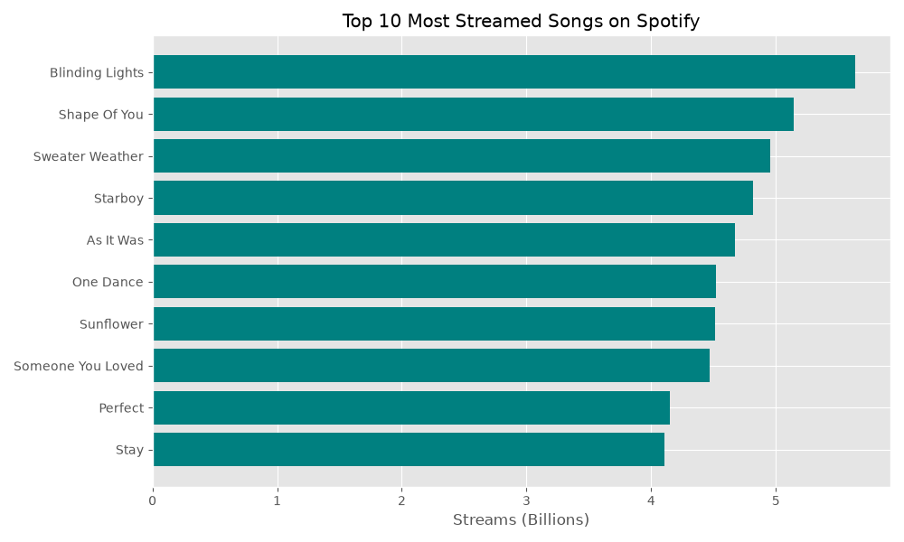

# Spotify Most-Streamed Songs Data Pipeline

An automated data engineering project that scrapes Spotify streaming data from Wikipedia, cleans it with Pandas, stores it in a SQLite database, and generates insights via Matplotlib.

**Tech stack:** Python, requests, BeautifulSoup, pandas, SQLite, matplotlib

*Sample output from a run on 2026-10-17. The source page changes over time, so a new run will produce different numbers.*

## Project Workflow
1. **Scraping**: Fetches live HTML using `requests` with custom headers.
2. **Parsing**: Utilizes `BeautifulSoup` to navigate DOM structures and extract tabular data.
3. **Cleaning**: Regex-based cleaning to remove Wikipedia citations and format numeric data.
4. **Storage**: Automated schema creation and data insertion into `SQLite`.
5. **Visualization**: Generation of bar charts showing streaming leaders.

## How to Run
1. Clone this repo: `git clone https://github.com/vdd11/spotify-data-pipeline.git`
2. Install dependencies: `pip install -r requirements.txt`
3. Run the script: `python scraper.py` (writes `spotify.db` and `top_10_streams.png`, both git-ignored)

## Technologies Used
- Python (Pandas, BeautifulSoup, Matplotlib, SQLite3)
- SQL
- Web Scraping
